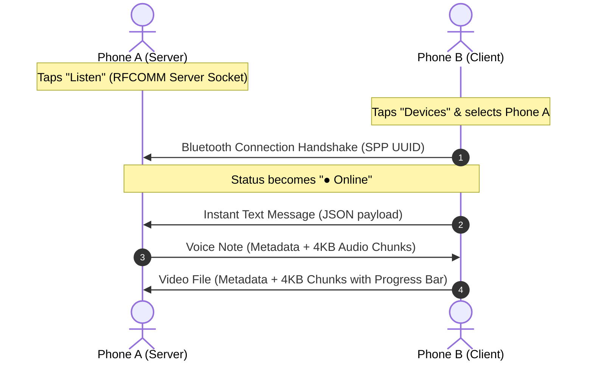

# 📱 BlueChat — WhatsApp-style Offline Bluetooth Messenger

**BlueChat** is a peer-to-peer (P2P) messaging application that works completely **offline** without internet over Bluetooth RFCOMM channels, built with **Python** & **Kivy**.

---

## 🎨 Interface Preview (UI Mockup)

```text
+------------------------------------------------+
| 👤 Partner Phone            [Listen] [Devices] |
|    ● Online                                    |
+------------------------------------------------+
|                                                |
|  +------------------------------------------+  |
|  | Hello! Connecting via Bluetooth SPP      |  |
|  |                                    12:00 |  |
|  +------------------------------------------+  |
|                                                |
|       +-------------------------------------+  |
|       | Hey! Sending you a voice note:      |  |
|       |                               12:01 |  |
|       +-------------------------------------+  |
|                                                |
|       +-------------------------------------+  |
|       | [▶]  ▂▃▅▆▇▆▅▃▂   00:14              |  |
|       | Voice Note                    12:01 |  |
|       +-------------------------------------+  |
|                                                |
|  +------------------------------------------+  |
|  | 🎬 sample_video.mp4 (4.5 MB)             |  |
|  | [████████████████████ 100%]              |  |
|  | [            Play Video                ] |  |
|  |                                    12:02 |  |
|  +------------------------------------------+  |
|                                                |
+------------------------------------------------+
| [📎] [ Type a message...              ] [🎙️] [➤]|
+------------------------------------------------+
```

---

## ✨ Features at a Glance

| Feature | Description |
| :--- | :--- |
| **💬 WhatsApp UI** | Signature teal bar (`#075E54`), outgoing green bubbles (`#DCF8C6`), incoming white bubbles (`#FFFFFF`). |
| **🎙️ Voice Notes** | Instant recording via mic `🎙️`, inline audio playback with waveform & duration. |
| **🎬 Video Sharing** | Send videos across Bluetooth with live progress tracking (`0% - 100%`) and one-click playback. |
| **📡 Dual Mode** | One device acts as **Server** (`Listen 📡`), the other acts as **Client** (`Devices 🔗`). |
| **⚡ 4KB Chunking** | Splits media into 4KB safe packets to avoid Bluetooth buffer overflows. |
| **💻 PC Simulator** | Test locally on Windows/Linux with simulated sockets before mobile deployment. |

---

## 🚀 Quick Start (Testing on PC)

### 1. Requirements
Ensure Python 3.11 is used:
```bash
py -3.11 -m pip install -r requirements.txt
```

### 2. Run Host (Instance 1)
Open Terminal 1:
```bash
py -3.11 main.py --port 8888
```
👉 Click **`Listen 📡`** on the top bar.

### 3. Run Partner (Instance 2)
Open Terminal 2:
```bash
py -3.11 main.py --port 8889
```
👉 Click **`Devices 🔗`** and select **`Simulated Partner A (Port 8888)`**.

Both windows will show **`● Online`** — you can now send text messages, record audio notes, and send videos!

---

## 📱 Building Android APK

### Option A: Free Cloud Build (GitHub Actions)
1. Push this repository to GitHub.
2. Go to the **Actions** tab on GitHub.
3. The APK will be automatically built by [.github/workflows/build_apk.yml](.github/workflows/build_apk.yml).
4. Download the compiled `.apk` from the **Artifacts** section and install it on both phones!

### Option B: Local Build (Linux / WSL)
```bash
pip install buildozer cython
buildozer -v android debug
```
The APK will be saved inside the `bin/` directory.

---

## 🔄 Architecture Flow


