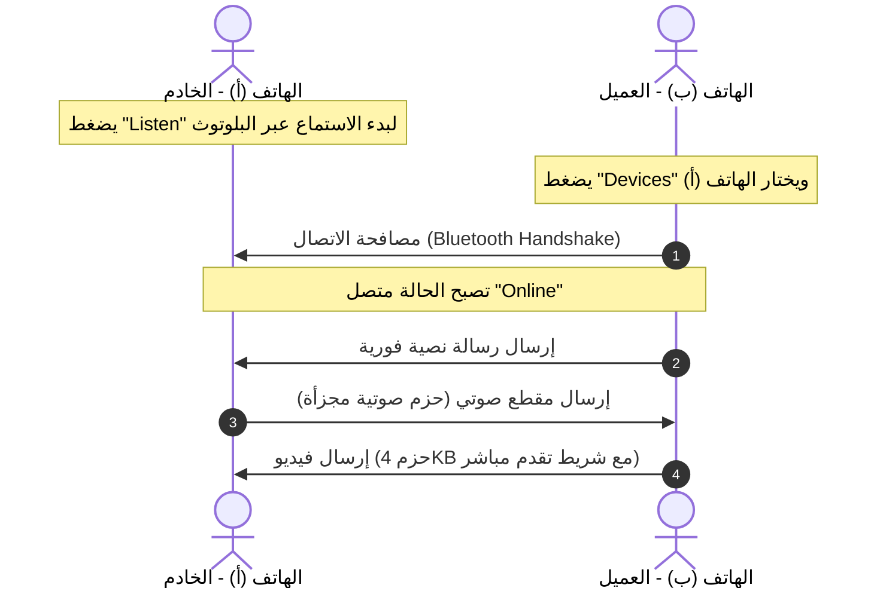

# 📱 تطبيق BlueChat — محادثة وبلوتوث بنمط واتساب بدون إنترنت

> **اللغة**: [English (الإنجليزية)](README.md) | **العربية**

تطبيق **BlueChat** هو تطبيق محادثة فوري يعمل بنظام (ند للند P2P) بالكامل **بدون إنترنت أو شبكة خلوية**، حيث يعتمد على قنوات البلوتوث التسلسلية (RFCOMM SPP)، ومبني بلغة **بايثون** باستخدام إطار العمل **Kivy**.

---

## 🎨 واجهة التطبيق التوضيحية (UI Preview)

```text
+------------------------------------------------+
| 👤 هاتف الطرف الآخر         [Listen] [Devices] |
|    ● متصل الآن (Online)                        |
+------------------------------------------------+
|                                                |
|  +------------------------------------------+  |
|  | مرحباً! الاتصال تم عبر البلوتوث بنجاح    |  |
|  |                                    12:00 |  |
|  +------------------------------------------+  |
|                                                |
|       +-------------------------------------+  |
|       | أهلاً بك! إليك تسجيل صوتي وفيديو:   |  |
|       |                               12:01 |  |
|       +-------------------------------------+  |
|                                                |
|       +-------------------------------------+  |
|       | [▶]  ▂▃▅▆▇▆▅▃▂   00:14              |  |
|       | Voice Note                    12:01 |  |
|       +-------------------------------------+  |
|                                                |
|  +------------------------------------------+  |
|  | 🎬 مقطع_فيديو.mp4 (4.5 MB)                |  |
|  | [████████████████████ 100%]              |  |
|  | [            Play Video                ] |  |
|  |                                    12:02 |  |
|  +------------------------------------------+  |
|                                                |
+------------------------------------------------+
| [📎] [ Type a message...              ] [🎙️] [➤]|
+------------------------------------------------+
```

---

## ⚡ أبرز الميزات في جدول سريع

| الميزة | الشرح باختصار |
| :--- | :--- |
| **💬 تصميم واتساب** | شريط علوي بلون واتساب، فقاعات خضراء وبيضاء وإشارات القراءة `✓✓`. |
| **🎙️ رسائل صوتية** | تسجيل مباشر بنقرة على الميكروفون `🎙️` مع مشغل مدمج ورسم موجي. |
| **🎬 مشاركة الفيديو** | نقل مقاطع الفيديو بحزم مجزأة وشريط تقدم لحظي وزر لمشاهدة الفيديو. |
| **📡 طريقتان للاتصال** | وضع **الخادم** (`Listen 📡`) ووضع **العميل** لاختيار الأجهزة المقترنة (`Devices 🔗`). |
| **🛡️ بروتوكول آمن** | تجزئة الحزم إلى 4KB لمنع تشويش قنوات البلوتوث أو فقدان البيانات. |
| **💻 محاكاة الكمبيوتر** | تشغيل نسختين على الكمبيوتر للتجربة قبل تحويل التطبيق إلى أندرويد. |

---

## 🚀 طريقة التجربة والتشغيل السريع على الحاسوب

### 1. تثبيت المتطلبات
تأكد من استخدام Python 3.11:
```bash
py -3.11 -m pip install -r requirements.txt
```

### 2. تشغيل الطرف الأول (خادم الاستماع)
افتح نافذة موجه الأوامر الأولى:
```bash
py -3.11 main.py --port 8888
```
👉 اضغط من الشريط العلوي على **`Listen 📡`**.

### 3. تشغيل الطرف الثاني (المتصل)
افتح نافذة ثانية جديدة:
```bash
py -3.11 main.py --port 8889
```
👉 اضغط من الشريط العلوي على **`Devices 🔗`** ثم اختر **`Simulated Partner A (Port 8888)`**.

ستتحول الحالة إلى **`● Online`** فوراً في النافذتين، ويمكنك البدء في إرسال النصوص والملاحظات الصوتية ومقاطع الفيديو!

---

## 📱 بناء وتثبيت تطبيق أندرويد (APK)

### الطريقة الأولى: بناء سحابي مجاني بنقرة واحدة (GitHub Actions)
1. أنشئ مستودعاً جديداً على GitHub وارفع إليه ملفات هذا المشروع:
   ```bash
   git init
   git add .
   git commit -m "BlueChat App"
   git remote add origin https://github.com/YOUR_USERNAME/YOUR_REPO.git
   git push -u origin main
   ```
2. ادخل على تبويب **Actions** في صفحة المستودع على GitHub.
3. سيقوم الملف [.github/workflows/build_apk.yml](.github/workflows/build_apk.yml) ببناء ملف APK تلقائياً.
4. قم بتحميل الملف من قسم **Artifacts** وتثبيته على هاتفي أندرويد.

### الطريقة الثانية: البناء محلياً عبر نظام لينكس أو WSL
```bash
pip install buildozer cython
buildozer -v android debug
```
ستجد ملف الـ APK داخل مجلد `bin/`.

---

## 🔄 مخطط تدفق الاتصال والبيانات


